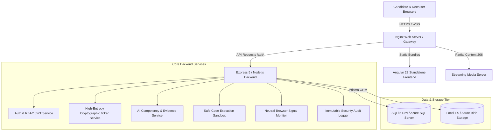

# TalentMind AI System Architecture

## 1. Architectural Overview

TalentMind AI is structured as a decoupled, multi-tier enterprise application designed for scale, high security, and verifiable AI ethics:



---

## 2. Ethical Human-in-the-Loop AI Hiring Engine

The platform operates under the core tenet that **AI must never replace human decision-making in employment decisions**:

```
                       ┌─────────────────────────┐
                       │   Job Description (JD)   │
                       └────────────┬────────────┘
                                    │ AI Competency Extraction
                                    ▼
                       ┌─────────────────────────┐
                       │ Standardized Rubric (1-5)│
                       └────────────┬────────────┘
                                    │
                                    ▼
┌─────────────────────────┐  Interview  ┌─────────────────────────┐
│ Candidate Video/Code/Text│ ──────────► │ Transcripts & Assertions│
└─────────────────────────┘             └────────────┬────────────┘
                                                     │ AI Grounded Evaluation
                                                     ▼
                                        ┌─────────────────────────┐
                                        │ Verbatim Quotes Evidence│
                                        │ Strengths & Gaps Report │
                                        └────────────┬────────────┘
                                                     │
                                                     ▼
                                        ┌─────────────────────────┐
                                        │ Human Recruiter Review  │
                                        │ • View video & code     │
                                        │ • Optional score override│
                                        │ • Advance or reject     │
                                        └─────────────────────────┘
```

### Key Ethical Safeguards:
1. **No Autonomous Hiring or Rejection:** The machine generates evidence cards and summaries; the human recruiter presses the button to advance or decline.
2. **Strict Evidence Grounding:** AI ratings must reference exact sentences from transcripts or lines from code solutions.
3. **No Affective or Demographical Inference:** The system completely avoids evaluating facial expressions, vocal inflections, attractiveness, accent, gender, or race.
4. **Transparent Score Overrides:** Whenever a recruiter changes a score, the platform requires an explanatory note that is permanently logged with user ID and timestamp.

---

## 3. Zero-Registration Candidate Flow

Candidates should never face friction, account creation fatigue, or password resets when taking an assessment:
1. **Cryptographic Token Creation:** The recruiter generates an invitation for a candidate. The system creates a 32-byte cryptographic random token (e.g. `priya-demo-active-invite-2026`).
2. **SHA-256 Hashing:** The database stores the SHA-256 hash of the token along with expiration and status.
3. **Single-Use Zero-Registration Validation:** When the candidate visits `/candidate/interview/:token`, the public endpoint verifies the token validity without requiring authentication headers.
4. **Session Lock:** Once submitted, the session status transitions to `COMPLETED`, locking further responses and triggering evaluation.

---

## 4. Neutral Browser Integrity Observation

Instead of accusatory "proctoring" or automated cheating flags, TalentMind AI utilizes a neutral observational event model:

| Observable Event | Technical Source | Severity | Default Uncertainty | Neutral Description |
|---|---|---|---|---|
| `TAB_VISIBILITY_HIDDEN` | `document.visibilityState === 'hidden'` | INFO | LOW | Browser document visibility hidden signal observed. |
| `FOCUS_LOST` | `window.onblur` | INFO | MEDIUM | Window focus lost signal observed. |
| `FULLSCREEN_EXITED` | `document.fullscreenElement === null` | MEDIUM | LOW | Fullscreen mode exited signal observed. |
| `CLIPBOARD_PASTE` | `paste` event | INFO | HIGH | External clipboard content pasted. |

* Recruiter reviewers examine signals with full awareness that candidates might switch tabs to look at documentation or respond to OS notifications.
* Recruiters can *Acknowledge* or *Dismiss* each event with a single click.

---

## 5. Storage & Partial Range Media Streaming

* Video and audio files are captured via WebRTC `MediaRecorder` as WebM blobs.
* The streaming endpoint (`/api/recordings/stream/:filename`) supports HTTP 206 Partial Content range requests (`bytes=start-end`), enabling instantaneous seeking and low-latency playback in all modern browsers.
